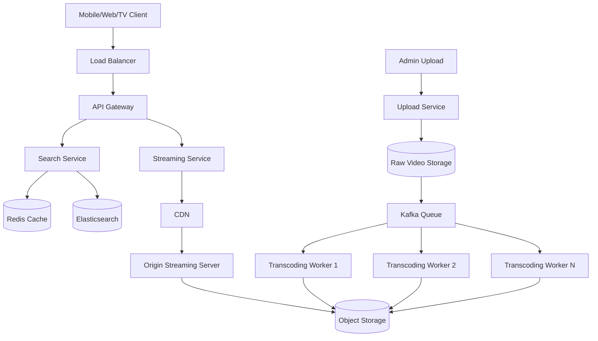

# Netflix Streaming Service - High Level Design

# Requirements

## Core Features

1. User should be able to:
   - Signup/Login
   - Search movies/series
   - Stream videos
   - Resume playback
   - Watch from multiple devices

2. System should support:
   - Mobile/Web/TV
   - Multiple video qualities:
     - 360p
     - 480p
     - 720p
     - 1080p
     - 2K
     - 4K

3. Video quality should automatically adjust according to internet speed.

4. Admin should be able to upload video content.

---

# Non Functional Requirements

1. Highly scalable
   - 100M+ DAU
   - Millions of concurrent streams

2. Highly available
   - Minimal downtime
   - Fault tolerant

3. Low latency streaming

4. Read heavy system

5. Smooth playback with minimal buffering

---

# Scope Clarification

For this discussion:
- Assume user authentication/payment already validated.
- Focus mainly on Video Streaming Architecture.

---

# High Level Components

1. Load Balancer
2. API Gateway
3. Search Service
4. Streaming Service
5. Metadata DB
6. CDN
7. Video Processing Pipeline
8. Object Storage
9. Cache

---

# APIs

## Search Content

```http
GET /content/search?title={title}&genre={genre}&language={language}
```

## Get Video Metadata

```http
GET /video/{videoId}
```

## Get Video Manifest File

```http
GET /manifest/{videoId}
```

Manifest file contains:
- available qualities
- chunk locations
- subtitle info

## Fetch Video Chunk

```http
GET /segment/{videoId}/{quality}/{segmentId}
```

Example:

```http
GET /segment/123/720p/segment45.ts
```

---

# Why Segment Based Streaming?

Entire movie is NOT sent at once.

Video is divided into small chunks:
- 5 sec
- 10 sec

Benefits:
- Faster playback start
- Low buffering
- Easy quality switching
- Efficient bandwidth usage

---

# Adaptive Bitrate Streaming

Player continuously monitors:
- internet speed
- device capability
- buffer health

Accordingly switches quality dynamically:

Example:
- Slow internet → 480p
- Good internet → 1080p
- Excellent internet → 4K

Protocols:
- HLS
- MPEG-DASH

---

# Search Service Design

## Metadata Storage

Store:
- title
- genre
- language
- actors
- duration
- thumbnails

## Database Choice

Use:
- Elasticsearch

Why?
- Partial search
- Fuzzy search
- Fast filtering
- Scalable indexing

Example:
- "harry pot" → Harry Potter

---

# Video Upload Pipeline

When admin uploads video:

```text
Upload Raw Video
        |
        v
Object Storage (Raw Video)
        |
        v
Kafka/Event Queue
        |
        v
Transcoding Workers
        |
        +--> 360p
        +--> 480p
        +--> 720p
        +--> 1080p
        +--> 4K
        |
        v
Store Processed Videos in Object Storage
        |
        v
Push Metadata to CDN
```

---

# Why Transcoding?

Single video is converted into:
- multiple resolutions
- multiple bitrates
- multiple device-compatible formats

Benefits:
- adaptive streaming
- smooth playback
- device compatibility

---

# Video Storage

Use Object Storage:
- Amazon S3
- Blob storage

Why?
- cheap
- scalable
- durable
- optimized for large files

---

# CDN Design

CDN is MOST IMPORTANT component.

Without CDN:
- origin server overloaded
- high latency
- buffering increases

Flow:

```text
User
  |
Nearest CDN Edge Server
  |
Cache Hit? ---- YES ---> Serve Immediately
  |
  NO
  |
Origin Streaming Server
  |
Object Storage
```

Benefits:
- low latency
- faster playback
- reduced backend traffic
- global scalability

---

# Cache Design

## Redis Cache

Used for:
- trending movies
- popular searches
- metadata cache

Benefits:
- reduce DB calls
- lower latency

---

# Database Design

## Relational DB

Store:
- users
- subscriptions
- payments

Examples:
- PostgreSQL
- MySQL

## NoSQL DB

Store:
- watch history
- playback progress

Examples:
- Cassandra
- DynamoDB

---

# Request Flow

# 1. Search Flow

```text
Client
   |
Load Balancer
   |
API Gateway
   |
Search Service
   |
Redis Cache
   |
Elasticsearch
   |
Return Results
```

---

# 2. Video Streaming Flow

```text
Client Player
    |
Load Balancer
    |
API Gateway
    |
Get Manifest File
    |
CDN Edge Server
    |
Chunk Available?
   / \
 YES  NO
  |     |
Serve   Fetch from Origin
Chunk       |
             v
       Streaming Service
             |
       Object Storage
```

---

# High Level Architecture



---

# Scalability

## Horizontal Scaling

Scale:
- API servers
- search nodes
- transcoding workers
- streaming servers

using:
- auto scaling groups
- container orchestration

---

# Availability

1. Multi-region deployment
2. CDN failover
3. Replicated storage
4. Health checks
5. Auto recovery

---

# Bottlenecks

## 1. CDN Cache Miss

Problem:
- origin traffic spike

Solution:
- pre-warm popular content

---

## 2. Large Video Upload Processing

Problem:
- transcoding expensive

Solution:
- distributed worker pool

---

## 3. Search Traffic

Problem:
- millions of searches/sec

Solution:
- Elasticsearch sharding
- Redis caching

---

# Tradeoffs

| Choice | Benefit | Drawback |
|---|---|---|
| CDN | Low latency | Expensive |
| Multiple video qualities | Smooth streaming | More storage |
| Chunk streaming | Better playback | More requests |
| Elasticsearch | Fast search | Operational complexity |

---

# Final Summary

1. Videos are pre-processed into multiple qualities.
2. Videos are divided into chunks.
3. CDN serves chunks from nearest edge server.
4. Player dynamically changes quality based on bandwidth.
5. Object storage acts as durable source of truth.
6. Search system uses Elasticsearch for scalable querying.
7. Entire system is optimized for:
   - low latency
   - high availability
   - massive scale
